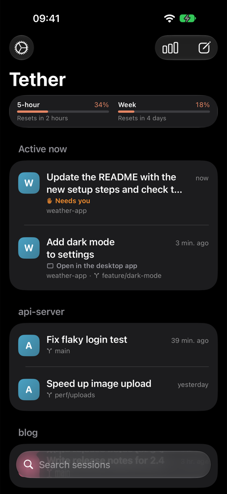
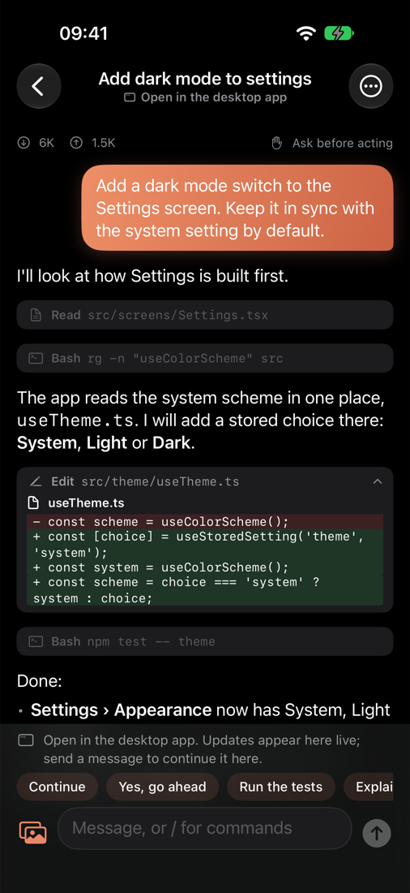
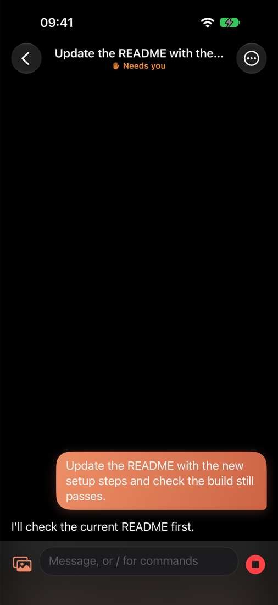
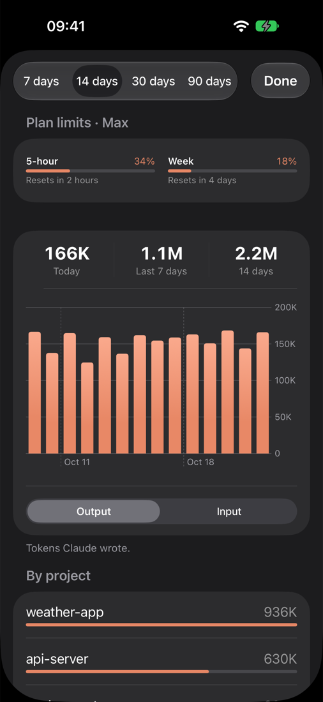

# Tether

[](https://github.com/MohammadSharafi/tether/actions/workflows/test.yml)

Watch and drive the Claude Code sessions on your Mac from your iPhone.

Tether is two small pieces that you run yourself:

- **`server/`**: a Node server on your Mac. It lists your local Claude Code sessions, reads token usage from their transcripts, sees which sessions are running in the desktop app or a terminal, and runs sessions you start from the phone through the Claude Agent SDK.
- **`ios/`**: a SwiftUI app for iPhone and iPad (iOS 17+).

Everything stays between your Mac and your phone. There is no Tether cloud service and no account.

<p align="center">
  
  
  
  
</p>

**New here? Follow the step-by-step [Setup guide](docs/GUIDE.md)** (about 20 minutes).

> Tether is an independent open-source project. It is **not affiliated with, endorsed by, or sponsored by Anthropic**. "Claude" and "Claude Code" are trademarks of Anthropic, PBC, used here only to describe what Tether works with.

## What it does

- **Session list**: sessions from all your Claude Code sessions folders (`~/.claude`, `~/.claude-*`, `$CLAUDE_CONFIG_DIR`), grouped by project, with search. **Active now** shows sessions that need you or are working, including ones **Running on your Mac** in the desktop app or a terminal, which update live. **Pinned** sessions stay at the top.
- **Live chat**: replies stream in, tool steps can be expanded, and file edits show as diffs. Long-press a message to copy it.
- **Approvals**: Allow, Always allow, or Deny with a note. Claude's multiple-choice questions and plans get their own cards.
- **New sessions**: the **Folder picker** browses your Mac's folders (inside your home folder); star favorites. Attach photos.
- **Session options** (••• menu): permission mode, model and **Effort** (Low to Max), **Slash commands** (also by typing `/`), the **Changes view** (uncommitted git changes, file by file), **Fork** a session, share the transcript as Markdown, rename, stop a turn, and **Stop on Mac** for sessions running there.
- **Quick replies**: one-tap messages such as "Continue" or "Run the tests"; edit them in Settings.
- **Tracking**: tokens per day, project and model, and the **Plan meter** with your plan's 5-hour and weekly limits.
- **Status**: a banner when Claude Code is logged out on the Mac, with the login state of each folder in Settings.
- **Notifications and Live Activity** (optional, needs a paid Apple Developer account): get notified when Claude needs you or finishes, and approve from the lock screen.
- **Appearance**: dark (default), light or system.

## Requirements

- A Mac with macOS 14 or later (developed on Apple silicon; Intel is untested).
- [Node.js](https://nodejs.org) 20.11 or later.
- [Claude Code](https://code.claude.com/docs) installed and logged in on the Mac (`claude`, then `/login`). Tether uses the same login; it never asks for or stores your credentials.
- [Tailscale](https://tailscale.com/download) on the Mac and on the iPhone, signed in to the same account. It connects the phone to the Mac from anywhere, encrypted.
- Xcode 16 or later and an Apple ID to install the app on your phone:
  - a **free Apple ID** works, but iOS stops the app after 7 days until you build it again, and push notifications are not available;
  - a **paid Apple Developer account** gives longer installs, push notifications and Live Activity updates while the app is closed.

## Setup

The short version is below. The [Setup guide](docs/GUIDE.md) covers every step in detail, with troubleshooting.

### 1. Mac

```bash
git clone https://github.com/MohammadSharafi/tether.git
cd tether/server
npm install
npm run setup
```

`npm run setup`:

- installs a login item (`~/Library/LaunchAgents/dev.tether.server.plist`) that starts the server when you log in and restarts it if it stops;
- runs `tailscale serve --bg 8787`, which makes the server reachable from your devices at `https://<your-mac>.<tailnet>.ts.net` (and only from devices in your tailnet);
- prints a QR code for pairing.

Show the QR code again any time with `npm run pair`. Remove the login item with `node setup.mjs --uninstall`.

If you use a custom Claude Code config folder, run setup with it, for example `CLAUDE_CONFIG_DIR=~/.claude-work npm run setup`.

### 2. iPhone

1. Create `ios/Config.local.xcconfig` (it is git-ignored) with your own values:

   ```
   DEVELOPMENT_TEAM = ABCDE12345
   BUNDLE_ID_PREFIX = io.github.yourname
   APP_ENTITLEMENTS =
   ```

   `DEVELOPMENT_TEAM` is your Team ID (Xcode › Settings › Accounts › your Apple ID). Leave `APP_ENTITLEMENTS` empty with a free Apple ID; set it to `Tether.entitlements` with a paid account to enable push notifications.
2. Open `ios/Tether.xcodeproj` in Xcode and run the **Tether** scheme on your iPhone.
3. Scan the QR code from `npm run pair` with the iPhone Camera and confirm, or enter the server address and token in the app's Settings.

## Configuration

### Server environment variables

| Variable | Default | Purpose |
|---|---|---|
| `CLAUDE_CONFIG_DIR` | `~/.claude` | Folder for new sessions started from the phone. Sessions from all folders are listed either way. |
| `PORT` | `8787` | Port on `127.0.0.1`. |
| `TETHER_TOKEN` | generated | Use this token instead of the one in `~/.tether/token`. |
| `PUBLIC_URL` | from Tailscale | Address put in the pairing QR code, if you expose the server another way. |

Set them before `npm run setup`; the login item keeps the values it was installed with.

### Files in `~/.tether`

| File | Content |
|---|---|
| `token` | The secret the phone sends with every request. Delete it and run setup again to change it (then pair again). |
| `apns.json` | Optional push notification settings (below). |
| `devices.json` | Phones registered for notifications. |
| `server.log` | Server output. |

### Push notifications (optional)

Requires a paid Apple Developer account and `APP_ENTITLEMENTS = Tether.entitlements`.

1. In [Certificates, Identifiers & Profiles](https://developer.apple.com/account/resources/authkeys/list), create a key with **Apple Push Notifications service (APNs)** enabled, download the `.p8` file, and note the Key ID and your Team ID.
2. Save the key, for example as `~/.tether/AuthKey.p8`, and create `~/.tether/apns.json`:

   ```json
   {
     "keyFile": "~/.tether/AuthKey.p8",
     "keyId": "ABC123DEFG",
     "teamId": "ABCDE12345",
     "bundleId": "io.github.yourname.Tether"
   }
   ```

   `bundleId` is `<BUNDLE_ID_PREFIX>.Tether`.
3. Run `npm run setup` again to restart the server. Its log says `Push notifications: on`.

Notifications are sent only when the app is not showing that session. Their text (session title, a short summary) passes through Apple's push service.

## Claude Code, the Agent SDK, and Anthropic's terms

Tether runs Claude Code through Anthropic's [Claude Agent SDK](https://code.claude.com/docs/en/agent-sdk/overview) (`@anthropic-ai/claude-agent-sdk`). Please read what that means before you use it:

- **The SDK is not open source.** It is © Anthropic PBC, all rights reserved, and its use is subject to Anthropic's [legal agreements](https://code.claude.com/docs/en/legal-and-compliance): the [Commercial Terms](https://www.anthropic.com/legal/commercial-terms) for API, Team and Enterprise users, and the [Consumer Terms](https://www.anthropic.com/legal/consumer-terms) for Free, Pro and Max users. It is not part of this repository and not covered by Tether's MIT license; `npm install` downloads it from npm, and it includes the Claude Code program.
- **Use your own account, for yourself.** Tether runs the unmodified Claude Code on your own Mac with the login you created through Anthropic's own sign-in. It never sees, stores or forwards your Claude credentials. Each person should run their own server with their own Claude account or API key. Do not use Tether to share one subscription with other people or to offer Claude to others as a service.
- **Building something for other people?** Anthropic states that developers building products with the Agent SDK should use API key authentication (via the [Claude Console](https://platform.claude.com/)), and that third-party developers may not offer Claude.ai login or route requests through Free, Pro or Max plan credentials on behalf of their users. To use an API key with Tether, log Claude Code in with your Console account (`claude`, then `/login`, then choose the Anthropic Console option). Check the current terms yourself; they can change.
- **Usage limits apply as usual.** Sessions started from the phone count against your plan or API usage. Anthropic notes that Pro and Max limits assume ordinary, individual usage. Some models need extra usage credits on some plans (Tether shows a notice; pick another model from the ••• menu).
- **Claude Code's own housekeeping.** Claude Code deletes session transcripts older than its `cleanupPeriodDays` setting (30 days by default) when it starts. Tether starts Claude Code briefly to read slash commands and plan limits, so that cleanup can run then too. Raise `cleanupPeriodDays` in Claude Code's settings if you want to keep sessions longer.

## Security

- The server listens on `127.0.0.1` only. Tailscale is the way in, and only for devices in your tailnet.
- Every request needs the secret token, stored in `~/.tether/token` (readable only by you) and in the iPhone Keychain.
- The app asks before connecting to a server from a pairing QR code.
- **Anyone with the token and access to your tailnet can run Claude Code on your Mac with your login.** Keep the token private; change it if it leaks.
- Stop on Mac only signals processes the server itself matched to that session; the phone never sends a process ID.
- The folder picker lists folders inside your home folder only.

## Limits

- A session open in the desktop app or a terminal updates live on the phone. Sending a message from the phone asks first, then stops it on the Mac (two writers on one session would conflict) and continues it on the phone. Reopen it on the Mac later to see the new messages.
- "Running on your Mac" comes from the process list: a Claude Code process started with `--resume <id>` (the desktop app always does this) is matched to that session, or to its newest transcript when Claude Code has moved the chat to a new file (same folder and title, written since the process started); a plain `claude` in a terminal is matched to the newest session in its folder.
- Live sessions close after 30 minutes idle; the next message resumes them.
- A session continued from the phone runs in the Tether server. Restarting the server (for example `npm run setup`) ends it; the next message resumes it. The desktop app shows the phone's messages after you reopen the session there.
- The phone shows the last 300 messages, each capped at 4,000 characters (Share transcript exports the full text).
- Plan limits show only when Claude Code is logged in with a Claude subscription.
- Live Activity updates while the app is closed need push notifications.

## Development

```bash
cd server
npm test        # unit tests with a fake SDK; no Claude usage
npm run e2e     # one real session against the running server (uses a little of your plan or API credit)
```

`npm run e2e` uses the Sonnet model by default; set `E2E_MODEL` to change it.

## Support

Tether is free and open source. If it saves you time, you can support its development on [Buy Me a Coffee](https://buymeacoffee.com/mohammadsh47).

<a href="https://buymeacoffee.com/mohammadsh47"></a>

## License

Tether is released under the [MIT License](LICENSE). Third-party components and their terms are listed in [THIRD_PARTY_NOTICES.md](THIRD_PARTY_NOTICES.md).
