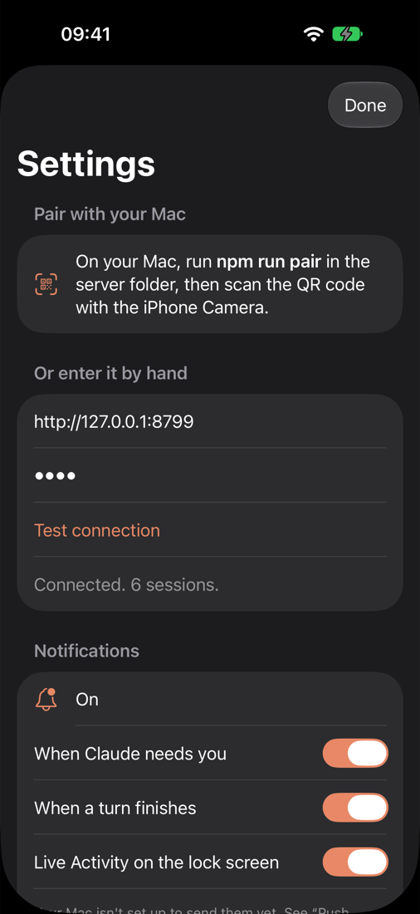

# Tether setup guide

This guide takes you from nothing to Tether running on your phone. It takes about 20 minutes, most of it waiting for installs.

You set up two things:

1. **The Tether server on your computer**, a Mac or a Windows PC. It reads your Claude Code sessions and runs the ones you continue from the phone.
2. **The Tether app on your phone**, an iPhone or an Android phone. You build it yourself, because Tether is not in an app store.

Any phone works with any computer. Tailscale connects them, so the phone reaches your computer from anywhere and nobody else can. The steps below say "Mac"; where Windows differs, a **Windows** note says how.

**Contents**

1. [Before you start](#1-before-you-start)
2. [Install the server on your Mac](#2-install-the-server-on-your-mac)
3. [Connect the Mac and the phone with Tailscale](#3-connect-the-mac-and-the-phone-with-tailscale)
4. [Build the app and install it on your iPhone](#4-build-the-app-and-install-it-on-your-iphone), or [on your Android phone](#4b-build-the-app-and-install-it-on-your-android-phone)
5. [Pair the app with your Mac](#5-pair-the-app-with-your-mac)
6. [Using Tether](#6-using-tether)
7. [Optional: push notifications and Live Activity](#7-optional-push-notifications-and-live-activity)
8. [Updating and removing](#8-updating-and-removing)
9. [Troubleshooting](#9-troubleshooting)

---

## 1. Before you start

You need:

| What | Why | Check |
|---|---|---|
| A Mac with macOS 14 or later | Runs the server | Apple menu › About This Mac |
| [Node.js](https://nodejs.org) 20.11 or later | Runs the server | `node --version` |
| [Claude Code](https://code.claude.com/docs), logged in | Tether drives it | `claude auth status` |
| [Xcode](https://apps.apple.com/app/xcode/id497799835) 16 or later | Builds the iPhone app | Open Xcode once and let it install its components |
| An Apple ID | Signs the app for your phone | A free one works (see below) |
| [Tailscale](https://tailscale.com/download) on the Mac and the iPhone | Connects them | Same account on both |
| A USB cable for the iPhone | For the first install | |

If Claude Code is not logged in, run `claude`, type `/login` and follow the steps.

**Free or paid Apple ID?**

- **Free Apple ID:** works. iOS stops the app after 7 days until you build it again (step 4, one click). No push notifications.
- **Paid Apple Developer account ($99/year):** installs last a year, and you get push notifications and lock-screen Live Activity updates.

You can start free and switch later.

---

## 2. Install the server on your Mac

Open Terminal (on Windows: PowerShell) and run:

```bash
git clone https://github.com/MohammadSharafi/tether.git
cd tether/server
npm install
npm run setup
```

`npm run setup` does three things:

1. Installs a **login item** (`~/Library/LaunchAgents/dev.tether.server.plist`). The server starts when you log in, and restarts if it stops.
2. Runs `tailscale serve --bg 8787`, so the server is reachable at `https://<your-mac>.<your-tailnet>.ts.net`. Only devices in your tailnet can reach it.
3. Prints a **QR code** for pairing. Leave it on screen for step 5, or show it again later with `npm run pair`.

The server itself listens only on `127.0.0.1:8787`. Nothing is opened to your local network or the internet.

> **Windows:** instead of a launchd item, setup writes a hidden launcher, `Tether.vbs`, into your Startup folder (`%APPDATA%\Microsoft\Windows\Start Menu\Programs\Startup`). It runs `%USERPROFILE%\.tether\start.cmd`, which starts the server and restarts it if it stops. No admin rights are needed and no window appears. Install [Node.js](https://nodejs.org), [Git](https://git-scm.com/download/win) and Claude Code first, and run `claude` once to log in.

> **If setup says "Serve is not enabled on your tailnet":** open the link it prints, approve it in the Tailscale admin page, then run `npm run setup` again.

> **Custom Claude Code folder?** If you use `CLAUDE_CONFIG_DIR`, run setup with it: `CLAUDE_CONFIG_DIR=~/.claude-work npm run setup`. Tether lists sessions from every `~/.claude*` folder either way.

Check that it runs:

```bash
curl -s -o /dev/null -w "%{http_code}\n" http://127.0.0.1:8787/info
```

It prints `401`. That's the right answer: the server is up and wants a token. (On Windows, use `curl.exe` instead of `curl` in PowerShell.)

---

## 3. Connect the Mac and the phone with Tailscale

1. Install Tailscale on the Mac and sign in.
2. Install Tailscale on the iPhone from the App Store and sign in **with the same account**.
3. On the iPhone, turn the Tailscale VPN switch on.

Check: in the Tailscale app on the phone, your Mac should be listed as connected.

---

## 4. Build the app and install it on your iPhone

### 4.1 Prepare the iPhone

1. Connect the iPhone to the Mac with the cable. Unlock it and tap **Trust**.
2. Turn on **Developer Mode**: Settings › Privacy & Security › Developer Mode › On. The phone restarts. (The switch appears after the phone has been connected to Xcode once; if you don't see it, do step 4.3 first and come back.)

### 4.2 Add your Apple ID to Xcode

Xcode › Settings › Accounts › **+** › Apple ID, and sign in. You'll see a team called "Your Name (Personal Team)".

### 4.3 Tell the project who you are

Create the file `ios/Config.local.xcconfig` in the repo. Git ignores it, so your details stay on your Mac:

```
DEVELOPMENT_TEAM = ABCDE12345
BUNDLE_ID_PREFIX = io.github.yourname
APP_ENTITLEMENTS =
```

- `DEVELOPMENT_TEAM`: your Team ID. Find it in Xcode › Settings › Accounts: select your team; the ID is 10 letters and digits. Or open the project, pick the Tether target › Signing & Capabilities, choose your team, and copy the ID Xcode shows.
- `BUNDLE_ID_PREFIX`: any reverse-domain name that is yours, for example `io.github.<your GitHub name>`. Bundle IDs must be unique across Apple, so don't use `com.example`.
- `APP_ENTITLEMENTS`: leave empty with a free Apple ID. Set it to `Tether.entitlements` with a paid account (needed for push notifications).

### 4.4 Build and run

1. Open `ios/Tether.xcodeproj` in Xcode.
2. At the top, pick the **Tether** scheme and your iPhone as the destination.
3. Press **Run** (⌘R).

The first time, the iPhone may refuse to open the app: go to Settings › General › VPN & Device Management, tap your Apple ID and **Trust**. Then open Tether.

> **Free Apple ID:** after 7 days the app stops opening. Connect the phone and press Run again. Your pairing and settings are kept.

---

## 4b. Build the app and install it on your Android phone

1. On the phone, turn on **Developer options** (Settings › About phone › tap **Build number** 7 times), then **USB debugging** in Settings › System › Developer options. Connect the phone with a cable and allow the computer when asked.
2. Build and install, with either:
   - **Android Studio:** open the `android/` folder, wait for it to finish syncing, pick your phone at the top and press **Run**.
   - **A terminal** (needs JDK 17 and the Android SDK, which Android Studio installs):

     ```bash
     cd tether/android
     ./gradlew assembleDebug
     adb install app/build/outputs/apk/debug/app-debug.apk
     ```

     On Windows, use `gradlew.bat assembleDebug`.
3. Open **Tether** on the phone and continue with step 5.

Before you share your own build with anyone, give it your own id: add `tether.applicationId=io.github.yourname.tether` to `android/gradle.properties`.

---

## 5. Pair the app with your Mac



1. On the Mac, show the QR code: `cd tether/server && npm run pair`.
2. On the phone, open the **Camera** and point it at the QR code. Tap the Tether banner (Android: tap the link the camera or Google Lens shows).
3. Tether opens Settings and asks **Connect to this Mac?** Check the address, then tap **Connect**.
4. Tap **Test connection**. It says "Connected. N sessions."

**No camera handy?** In Settings, under "Or enter it by hand", type the server address (`https://<your-mac>.<your-tailnet>.ts.net`) and the token. The token is in `~/.tether/token` on the Mac (Windows: `%USERPROFILE%\.tether\token`).

The token works like a password for your Mac. Don't share the QR code or the token.

<br clear="right">

---

## 6. Using Tether

### The session list


- **Plan meter** (top): how much of your plan's 5-hour and weekly limits you've used. Shown when Claude Code is logged in with a Claude subscription.
- **Active now:** sessions that need you (orange "Needs you"), are working, or are **open in the desktop app or a terminal** on your Mac.
- Below: all other sessions, grouped by project. Pull down to refresh. Use the search box at the bottom.
- Swipe a session to **pin** it to the top, rename it, or delete it.
- **Bar chart button:** token usage. **Pencil button:** start a new session.

<br clear="right">

### A session


- Messages update live. Tap a tool step to expand it; file edits show as a diff.
- Long-press a message to copy it.
- The **quick replies** above the message box send one tap messages ("Continue", "Run the tests"). Edit them in Settings.
- Type `/` for **slash commands**.
- The photo button attaches images.

The **•••** menu has: permission mode, model, effort, slash commands, the **Changes** view (uncommitted git changes in the project), **Fork**, **Share transcript** (as Markdown), rename, **Stop** (the current turn) and **Stop on Mac**.

<br clear="right">

### Approvals


When Claude wants to run a command or edit a file, a card shows what it wants to do:

- **Allow** runs it once.
- **Always allow** (when offered) allows that kind of action for the rest of the session.
- **Deny** refuses it. You can add a note telling Claude what to do instead.

Questions from Claude (multiple choice) and plans get their own cards.

<br clear="right">

### Sessions open on your Mac

If a session is open in the Claude desktop app or a terminal, the phone shows it live and marks it **Open in the desktop app** (or **Terminal**).

You can still send a message to it from the phone. Tether asks first: **Continue this chat on your phone?** If you tap **Continue here**, it stops the session on the Mac (like pressing Ctrl-C there) and runs it from the phone. Only one program should write to a session at a time; otherwise the session splits into two versions.

Going back to the Mac: reopen the session in the desktop app. It shows everything you did on the phone. The desktop app only reads a session when you open it, so it doesn't update live while you chat from the phone.

### Starting a new session

Tap the pencil button, pick a folder on your Mac (inside your home folder; star favorites), choose a model and permission mode, and type the first message.

### Usage


The bar chart button shows tokens per day for 7 to 90 days, split by project and model, read from your Claude Code transcripts. **Output** is what Claude wrote; **Input** includes cached context.

<br clear="right">

---

## 7. Optional: push notifications and Live Activity

Needs a paid Apple Developer account.

1. Set `APP_ENTITLEMENTS = Tether.entitlements` in `ios/Config.local.xcconfig` and run the app again from Xcode.
2. In [Certificates, Identifiers & Profiles › Keys](https://developer.apple.com/account/resources/authkeys/list), create a key with **Apple Push Notifications service (APNs)**. Download the `.p8` file (you can download it only once) and note the **Key ID**.
3. Save it as `~/.tether/AuthKey.p8` and create `~/.tether/apns.json`:

   ```json
   {
     "keyFile": "~/.tether/AuthKey.p8",
     "keyId": "ABC123DEFG",
     "teamId": "ABCDE12345",
     "bundleId": "io.github.yourname.Tether"
   }
   ```

   `bundleId` is your `BUNDLE_ID_PREFIX` followed by `.Tether`.
4. Run `npm run setup` again. `~/.tether/server.log` now says `Push notifications: on`.
5. In the app's Settings, turn notifications on and pick what you want: when Claude needs you, when a turn finishes, and the Live Activity on the lock screen.

You can then answer approvals straight from the lock screen. Notifications are sent only when the app isn't showing that session. Their text (session title and a short summary) passes through Apple's push service.

---

## 8. Updating and removing

**Update:**

```bash
cd tether
git pull
cd server && npm install && npm run setup
```

Then press Run in Xcode (or Android Studio) to update the app.

Restarting the server ends any session you are running from the phone. The next message resumes it.

**Remove:**

```bash
cd tether/server
node setup.mjs --uninstall
tailscale serve --https=443 off
rm -rf ~/.tether
```

Then delete the app from the phone.

**Windows:** `node setup.mjs --uninstall` stops the server and removes the Startup launcher. Remove the state folder with `Remove-Item -Recurse $HOME\.tether`.

---

## 9. Troubleshooting

**"Can't reach your Mac. Check that it's awake and on Tailscale."**
- Is the Mac awake? A sleeping Mac can't answer. System Settings › Energy can keep it awake while plugged in.
- Is Tailscale on, on both devices, with the same account?
- On the Mac, does `curl -s -o /dev/null -w "%{http_code}\n" http://127.0.0.1:8787/info` print `401`? If not, run `npm run setup` again.

**"Tether on your Mac is not answering. Retrying…"**
Tailscale reached the Mac but the server isn't running, often because it is restarting. Wait a few seconds; the app retries on its own. If it lasts, check `~/.tether/server.log` and run `npm run setup`.

**"Missing or wrong token."**
The phone's token doesn't match `~/.tether/token`. Pair again with `npm run pair`.

**Banner: Claude Code is logged out.**
Run `claude` on the Mac and type `/login`. The app's Settings lists each Claude Code folder with its login state.

**"This model requires usage credits."**
Your plan doesn't include that model. In the session, open ••• › Model and pick another one.

**A session shows old messages.**
Pull down to refresh the list, or go back and open the session again. Claude Code sometimes moves a long chat into a new transcript file; Tether follows it to the newest file.

**The app won't open after a week.**
Free Apple ID installs expire after 7 days. Connect the phone and press Run in Xcode.

**Where are the logs?**
`~/.tether/server.log` on the Mac.

**Checking the server:**

```bash
cd tether/server
npm test        # unit tests, no Claude usage
npm run e2e     # one short real session (uses a little of your plan)
```
